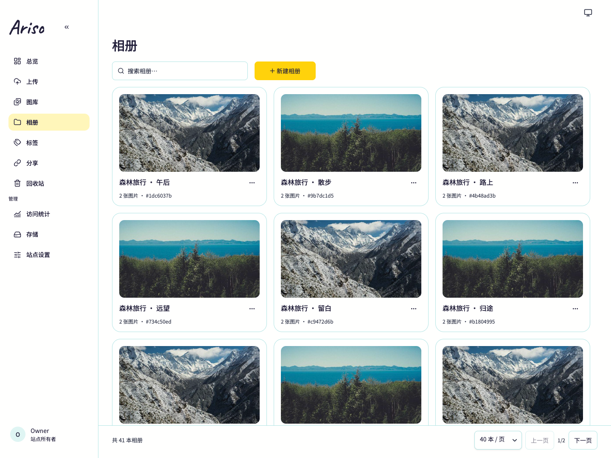
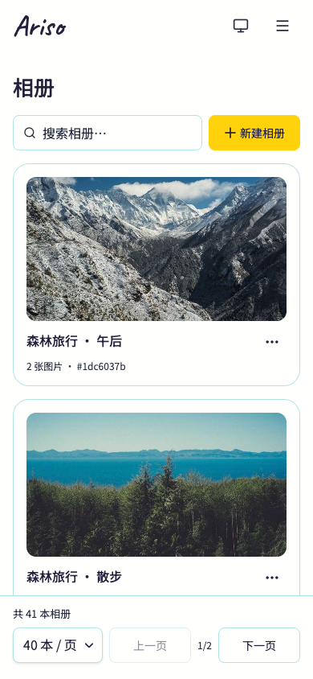

<div align="center">

# Ariso

**自己的图片，自己的图床。**

单用户、自托管图床。上传、整理、处理和分享图片，让博客配图、项目素材和个人相册有一个自己的家。

[快速开始](#快速开始) · [功能](#功能) · [文档](#文档) · [版本下载](https://github.com/dnslin/ariso-next/releases) · [反馈问题](https://github.com/dnslin/ariso-next/issues)

[](https://github.com/dnslin/ariso-next/releases)
[](https://github.com/dnslin/ariso-next/actions/workflows/ci.yml)

</div>

## 界面预览



<details>
<summary>查看手机界面</summary>

<p align="center">
  
</p>

</details>

截图来自实际运行的产品，使用示例图片。

## 功能

| 功能       | 你可以做什么                                               |
| ---------- | ---------------------------------------------------------- |
| 图片上传   | 选择文件或文件夹、拖放、粘贴图片，通过队列查看进度与结果   |
| 图库管理   | 搜索、筛选和排序图片，切换网格或瀑布流，批量整理与复制链接 |
| 相册与标签 | 按项目、主题或旅行整理图片，为相册选择封面                 |
| 图片处理   | 保留原图，生成压缩图和水印图，查看元数据，按新设置重新处理 |
| 访问与分享 | 设置图片公开或私有，创建带密码、有效期的相册分享           |
| 存储管理   | 使用本地目录或 S3 兼容对象存储，配置连接并测试可用性       |
| 上传 API   | 使用独立 Token 上传，通过 OpenAPI 文档接入脚本和工具       |
| 回收与统计 | 从回收站恢复图片，查看图片访问趋势与存储用量               |
| 站点外观   | 自定义名称、描述、Logo 和图标，切换浅色、深色或跟随系统    |

Ariso 面向一个站点所有者。访客通过公开图片地址或相册分享浏览内容；站点不开放多人注册。

## 快速开始

正式部署使用 Docker Compose，支持 `linux/amd64` 和 `linux/arm64`。应用使用 SQLite，无需单独部署数据库。

[GitHub Releases](https://github.com/dnslin/ariso-next/releases) 提供版本镜像及离线镜像包。使用已发布镜像时，按[部署指南](./docs/guides/deployment.md#正式部署目录)准备独立部署目录。

下面从源码构建并启动，需要 Docker、Compose v2 和 OpenSSL。

### 1. 获取项目

```sh
git clone https://github.com/dnslin/ariso-next.git
cd ariso-next
cp .env.example .env.local
```

### 2. 配置密钥

分别生成认证密钥和加密密钥：

```sh
openssl rand -base64 32
openssl rand -hex 32
```

把第一条输出填入 `.env.local` 的 `BETTER_AUTH_SECRET`，第二条输出填入 `ARISO_ENCRYPTION_KEY`。保存好这个文件，升级时继续使用原有密钥。

Compose 固定使用容器内的 `/data`，无需修改 `.env.local` 中供本地开发使用的 `DATA_DIR`。

### 3. 启动

```sh
mkdir -p .data
```

Linux 上还需让容器用户可以写入这个目录：

```sh
sudo chown 1000:1000 .data
```

```sh
docker compose --env-file .env.local up --build --detach --wait
```

打开 [http://127.0.0.1:3000](http://127.0.0.1:3000)，按页面提示创建所有者账号并配置站点，然后登录上传第一张图片。

默认端口仅供本机访问。需要域名或外部访问时，通过反向代理接入，并把站点公开地址设为实际访问地址。完整配置见[部署指南](./docs/guides/deployment.md)。

数据库、默认本地图片及站点资源保存在 `.data/`。升级前同时备份数据和密钥，操作步骤见[升级与恢复](./docs/guides/upgrading.md)。

## 文档

| 需要做什么                   | 从这里开始                                                                                    |
| ---------------------------- | --------------------------------------------------------------------------------------------- |
| 部署、配置反向代理或恢复密码 | [Docker 部署](./docs/guides/deployment.md)                                                    |
| 升级、备份与恢复             | [升级指南](./docs/guides/upgrading.md)                                                        |
| 从源码开发、构建和运行检查   | [开发指南](./docs/guides/development.md)                                                      |
| 对接上传 API                 | 初始化站点后访问 `/api/openapi.json`；[接口契约](./docs/specs/SPEC-upload.md#10-通用上传-api) |
| 了解产品规则和模块职责       | [文档导航](./docs/README.md)                                                                  |

## 常见问题

<details>
<summary><strong>必须使用对象存储吗？</strong></summary>

不需要。可以使用本地存储，也可以在后台添加 S3 兼容对象存储。启用前先测试连接；Web 直传还需要配置并检查 CORS，也就是允许浏览器跨域上传的规则。

</details>

<details>
<summary><strong>怎么把图片放到博客里？</strong></summary>

上传后复制图片链接，或在图库中批量复制 URL、Markdown、HTML。需要让读者直接查看的图片应设为公开；私有图片链接不会因为复制或嵌入而变成公开。

</details>

<details>
<summary><strong>如何查看更新和开发进度？</strong></summary>

已发布版本与更新说明见 [Releases](https://github.com/dnslin/ariso-next/releases)。开发任务见 [Issues](https://github.com/dnslin/ariso-next/issues)，验收范围与证据从[文档导航](./docs/README.md)进入。

</details>

## 本地开发

使用 Node.js 24.x 和 pnpm 11.19.0。环境配置、启动命令、生产构建及检查要求统一见[开发指南](./docs/guides/development.md)。

主要技术栈为 Next.js、React、TypeScript、HeroUI、Tailwind CSS、SQLite 和 Drizzle ORM；图片处理使用 ImageMagick 与 ExifTool。

## 参与贡献

欢迎通过 [Issue](https://github.com/dnslin/ariso-next/issues) 反馈问题或提出建议。报告问题时，请提供版本、部署方式、复现步骤及相关日志。

提交改动前请阅读 [AGENTS.md](./AGENTS.md) 和[任务执行与验证约定](./docs/guides/verification.md#适用检查)。涉及界面的改动还需遵守[设计交付规范](./docs/design/handoff.md)。
