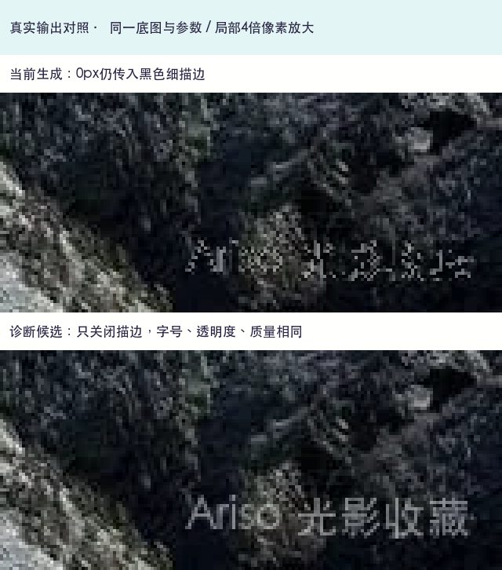

# Favicon 优化与水印零宽描边修复

本次 PR 仅交付两个已获用户批准的媒体处理变更，无产品页面布局改动。

## 最终行为

- Favicon 上传 PNG、ICO、静态 SVG 后生成 48×48 PNG，等比缩放、透明居中，不裁剪、拉伸或减少颜色；去除无关元数据并采用无损压缩。ICO 选择合适帧，小 SVG 直接按目标尺寸栅格化。生成或数据库提交失败保留原图标，Logo 仍保存原文件。
- 文字水印描边宽度为0时显式关闭描边，大于0时继续采用指定颜色和宽度。字号、透明度、质量和其他设置不变。
- 既有 Favicon 不迁移，重新上传时生成优化文件；既有图片重新处理后应用水印修复。

不包含统计布局、侧栏描述、本地原型、额外默认值调整或依赖变更。

## 真实输出证据

| 样例             | 输入字节数 | 最终PNG字节数 | 尺寸  |
| ---------------- | ---------: | ------------: | ----- |
| 复杂照片 Favicon |    625,365 |         4,850 | 48×48 |
| 简单标识 Favicon |        373 |           484 | 48×48 |

见 [Favicon 记录](outputs/favicon-report.json)、[照片输出](outputs/favicon-complex-photo.png)与[标识输出](outputs/favicon-simple-symbol.png)。简单SVG源本来很小，转换PNG后略大；目标是实际加载的小尺寸图标，不要求任何输入都必须缩小字节数。

水印的 [修复前输出](outputs/text-current.webp)与[产品修复后输出](outputs/text-fixed.webp)采用同一张640×480照片、3%字号、50%透明度、WebP质量82，仅关闭零宽描边。[实际记录](outputs/fixed-report.json)确认产品输出与用户批准候选的像素差为0。

## 本地验证

环境：macOS ARM64、Node24.18.1、pnpm11.19.0、ImageMagick7.1.2-33、ExifTool。构建仅有已有的可选resvg跨平台模块追踪诊断，退出码0；本机真实SVG渲染测试通过。

| 实际命令                                                                                                                                                                                                                                  | 结果                                              |
| ----------------------------------------------------------------------------------------------------------------------------------------------------------------------------------------------------------------------------------------- | ------------------------------------------------- |
| `pnpm install --frozen-lockfile`                                                                                                                                                                                                          | 通过                                              |
| `pnpm run build`                                                                                                                                                                                                                          | 通过                                              |
| `pnpm run typecheck`                                                                                                                                                                                                                      | 通过                                              |
| `pnpm run lint`、`pnpm run format:check`                                                                                                                                                                                                  | Favicon阶段全局检查通过，水印最终改动定向检查通过 |
| `pnpm exec vitest run --project media-tools tests/integration/site/branding.test.ts tests/integration/site/branding-http.test.ts tests/integration/media/svg.test.ts tests/integration/media/watermark.test.ts`                           | Favicon阶段94/94通过                              |
| `pnpm exec vitest run --project media-tools tests/integration/media/watermark.test.ts -t 'renders zero-width'`（修复前）                                                                                                                  | 新增中文、拉丁字体用例均按预期失败                |
| `pnpm exec vitest run --project media-tools tests/integration/media/watermark.test.ts`（修复后）                                                                                                                                          | 32/32通过                                         |
| `pnpm exec vitest run --project media-tools tests/integration/media/preview.test.ts tests/integration/media/reprocess.test.ts`                                                                                                            | 55/55通过                                         |
| `pnpm exec vitest run --project unit tests/unit/media/processing.test.ts tests/unit/media/watermark.test.ts tests/unit/site/branding-controls.test.ts tests/unit/site/branding-editor.test.ts tests/unit/site/branding-resources.test.ts` | 21/21通过                                         |
| `pnpm exec vitest run --project unit tests/unit/media/svg-policy.test.ts`                                                                                                                                                                 | 52/52通过                                         |
| `git diff --check`                                                                                                                                                                                                                        | 通过                                              |

回归覆盖真实PNG尺寸/透明边距/元数据、ICO选帧、小SVG像素锐度、生成与提交失败保留旧文件，以及零宽描边像素、非零描边、文字转义和图片水印。零宽描边修复保留了参考图片的逐像素与尺寸断言。评审中将ICO选帧条件临时从 `>=48` 改为 `>48`，原生48帧用例按预期失败，恢复后通过。

本机无Docker，未执行Linux生产镜像媒体测试；由PR的Media tools作业验证，结果以实际CI为准。不同像素密度下标签栏的人工视觉验收尚未完成。无Figma同步、数据库迁移、发布或部署。
